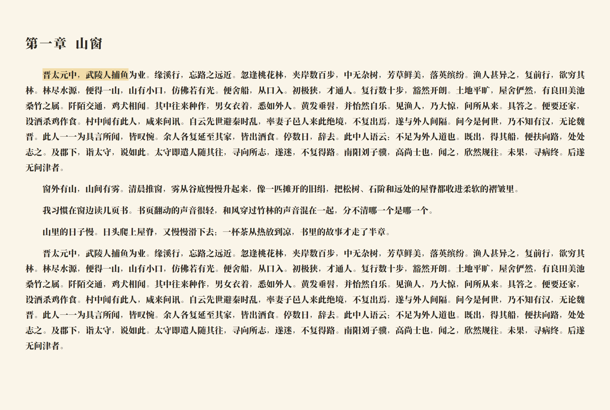
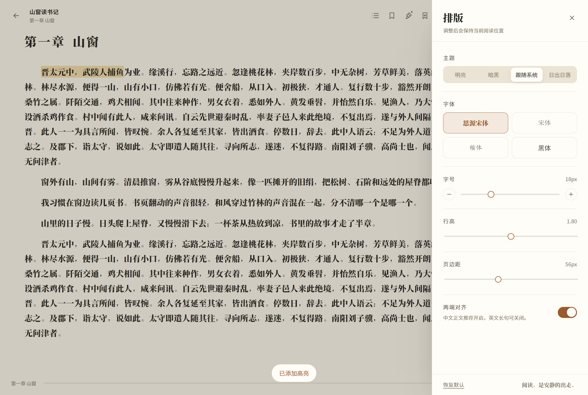

<div align="center">

# 📖 Ebook Viewer

[English](./README.en.md) | [简体中文](./README.md)

A focused local EPUB reader with a library, table of contents, bookmarks, light/dark themes, and a transparent always-on-top “stealth” reading window that adapts to the desktop behind it.

> Current version: **v1.0.5** · [GitHub Releases](https://github.com/Bright9025/ebook-viewer/releases)

</div>

## 🆕 What's New in v1.0.5

- **No silent updates**: the first launch only checks and records an available version. The next launch asks whether to download it; after download, the app asks again before restarting. Quitting never installs automatically.
- **Updates keep the original install directory**: the updater uses the current program directory, so program and library directories are not moved.
- The prompt names the source (GitHub Releases) and checksum verification; library data, books and progress are untouched.
- v1.0.4 prompt-based updating and v1.0.3 data migration remain.

### v1.0.3 highlights

- Library data moved to `%LOCALAPPDATA%\Ebook Viewer\`, so updates no longer overwrite books or progress.
- Installer backs up old `data/` before upgrading; first launch has a fallback migration.
- `electron-updater` integration and a manual update check in Settings.

### v1.0.2 highlights

- Custom annotation palette with rename, color change, add and remove.
- Data and pure EPUB exports; the data edition restores annotations, bookmarks and progress when imported back.
- Library actions via hover “···” or right-click.
- Bulk export/delete and duplicate-title suffixes.
- Settings center with sunrise/sunset auto theme, four built-in fonts, local font import/removal and reset-to-default.
- Fixes for oversized highlights, over-broad annotation hit areas and dark-mode black underlines.

## ✨ Features

- 📚 **Local library** – Import EPUB files by button or drag-and-drop; extract covers, titles, authors and descriptions; remember recently read books and progress.
- 📖 **Focused reader** – Horizontal pagination, table of contents, bookmarks, font size / line height / margins / font family / justification.
- ✍️ **Text annotations** – Select text, then right-click to copy, add a highlight, underline, wavy underline or note in the current palette color. Annotations are saved per book and can be jumped to, edited or deleted from the sidebar.
- 📤 **Two export modes** – The data version includes Reading Notes, annotations, bookmarks and progress; the pure version copies the original EPUB with no annotations.
- 🧭 **Library actions** – Hover a book to reveal “···”, or right-click it, for details, export and delete.
- ☑️ **Bulk actions** – Enter selection mode on the library page to export or delete multiple books.
- 🎨 **Appearance** – Light / dark / system / sunrise-sunset auto; configurable reading fonts and annotation colors, font import and reset-to-default.
- 🏷️ **Duplicate imports** – Importing books with the same title shows `Title-1`, `Title-2`, etc.
- 🌗 **Reading theme** – Switch the UI and book typography together, follow the system, or use local sunrise/sunset times.
- 🪟 **Resizable window** – Re-paginate when the window, font size or margins change, keeping the previous anchor sentence on the current page without reloading the book.
- 🫥 **Stealth mode** – A small transparent, topmost window whose text color follows the pixels underneath, character by character. Drag it, resize it, hide it or exit it at any time.
- ⌨️ **Global shortcuts** – Show/hide everything or toggle stealth mode from anywhere; arrow keys turn pages in the stealth window.
- 🧰 **Tray resident** – Closing the main window keeps the app in the tray. EPUB files are never modified.

## 🖼️ Screenshots

| Library | Settings |
| --- | --- |
|  |  |

| Reader · light | Reader · dark |
| --- | --- |
|  |  |

| Typography settings | Export mode |
| --- | --- |
|  |  |


> The stealth window is transparent and always on top. The preview above shows the transparent page over a light background; the actual text color changes with the desktop underneath.

## 📁 Project Structure

```text
ebook-viewer/
├── docs/
│   └── screenshots/              # UI screenshots referenced by the READMEs
├── resources/
│   ├── icons/                    # App, tray and installer icons
│   └── launcher/                 # Windows launcher source and binary
├── samples/                      # Sample EPUBs for tests
├── scripts/
│   ├── dev/                      # Development / preview launcher wrapper
│   ├── setup/                    # Electron binary bootstrap
│   └── test/                     # End-to-end smoke test
├── src/
│   ├── main/                     # Electron main process
│   ├── preload/                  # contextBridge API
│   ├── renderer/                 # Vue 3 UI
│   └── shared/                   # Shared types and defaults
├── .gitignore
├── .npmrc                        # Electron download mirror
├── LICENSE                       # MIT License
├── THIRD_PARTY_NOTICES.md        # Third-party licenses and notices
├── CONTRIBUTING.md               # Contribution guide
├── README.md                     # Chinese documentation
├── README.en.md                  # English documentation (this file)
├── electron-builder.yml          # Windows packaging config
├── electron.vite.config.ts       # main / preload / renderer build config
├── package.json
├── package-lock.json             # Locked dependency versions
├── tsconfig.json                 # TypeScript project references
├── tsconfig.node.json            # Main / preload / shared typecheck
└── tsconfig.web.json             # Renderer typecheck
```

`out/` and `release/` are local build artifacts and are ignored by `.gitignore`; they are not committed.

## 🚀 Quick Start

### Requirements

- Windows 10 / 11
- Node.js ≥ 22.12
- npm ≥ 10

The project is pinned to **Electron 33.4.11**. On the Windows 10 19045 machine used for development (with a CJK project path), newer Electron versions crash while initializing the default user-data directory (`0xC0000005`). Electron 33 with a local `data/` directory starts reliably and is covered by the end-to-end test.

### Install and develop

```bash
npm install
npm run dev
```

`npm run dev` passes `--noSandbox` and clears `ELECTRON_RUN_AS_NODE`; locked-down Windows sessions cannot initialize Chromium's sandbox, and without these flags the process exits immediately without a window.

If Chromium's sandbox works normally on your machine, use the default secure configuration:

```bash
npm run dev:secure
```

### Build and package

```bash
npm run build        # Compile main / preload / renderer into out/
npm run start        # Preview the production build (with --noSandbox)
npm run pack         # Produce release/win-unpacked
npm run dist         # Produce an NSIS installer (requires extra packaging components)
```

The double-click entry in `release/win-unpacked` is **`Ebook Viewer.exe`**, a tiny launcher that starts **`EbookViewerCore.exe`** (the Electron app) with `--no-sandbox`. Keep the whole directory together; do not copy just one of the two executables.

`启动 Ebook Viewer.cmd` is an equivalent command-line entry.

The packaged `release/` directory looks like this:

```text
release/
├── win-unpacked/                 # Portable build
│   ├── Ebook Viewer.exe          # Double-click launcher
│   ├── EbookViewerCore.exe       # Electron app
│   ├── 启动 Ebook Viewer.cmd
│   └── data/                     # Chromium profile (library data is not stored here)
├── Ebook-Viewer-1.0.5-x64.exe    # NSIS installer
├── Ebook-Viewer-1.0.5-x64.exe.blockmap
├── Ebook-Viewer-v1.0.5-x64-portable.zip
├── latest.yml
└── builder-debug.yml             # electron-builder debug info (ignored)
```

For a GitHub Release, upload `Ebook-Viewer-1.0.5-x64.exe` and `Ebook-Viewer-v1.0.5-x64-portable.zip`; the blockmap and `latest.yml` are installer/auto-update helpers and optional.

## 📚 Usage

1. Launch the app, then click **Import EPUB** or drag an EPUB into the library.
2. Click a cover to start reading. Locations are generated on first open and progress is saved automatically.
3. The top bar opens the table of contents, annotation list, bookmarks, adjusts typography, switches themes, enters fullscreen, and provides minimize / maximize / close controls.
4. Select text and right-click to copy, add a highlight, underline or wavy underline in the current palette color, or a note; click an existing annotation to edit or delete it.
5. Click the **Stealth** button in the reader toolbar, or press `Ctrl+Shift+M`, to open the transparent topmost window.
6. In the stealth window, use `←` / `→` to turn pages; drag the top 26px to move it; drag the bottom-right grip to resize; use the top-right toolbar to hide or exit.
7. Click export in a book's “···” menu or in the reader toolbar, choose an export mode and a destination folder; the file name is generated automatically.

## ⌨️ Shortcuts

| Shortcut | Action |
| --- | --- |
| `←` / `→` / `PgUp` / `PgDn` / `Space` | Previous / next page |
| `Esc` | Close panels; hide the stealth window |
| `F11` | Fullscreen |
| `Ctrl+Shift+H` | Global boss key: hide / restore all windows |
| `Ctrl+Shift+M` | Toggle stealth mode globally |
| Double-click the stealth window | Exit stealth mode and return to the main window |

If a hotkey is occupied by another application, the settings panel reports it. Hotkeys can be changed in `settings.hotkeys` inside `data.json`.

## 🗂️ Data Location

The app stores data next to the executable in a portable `data/` directory:

- Development: `ebook-viewer/.data/`
- Installed / portable: `%LOCALAPPDATA%\Ebook Viewer\`
- Chromium profile: still next to the executable in `data/` (safe to lose on update)

Contents:

- `data.json` – library, settings, bookmarks and reading progress
- `books/` – imported EPUB copies
- `fonts/` – imported local reading fonts
- `exports/` – fallback destination when a selected export folder is blocked

When upgrading from v1.0.2 to v1.0.3 / v1.0.4 / v1.0.5, the installer copies the old install folder's `data/` into `%LOCALAPPDATA%\Ebook Viewer\` before removing it; a first-launch migration also handles older portable copies.

Override the location with the `EBOOK_USER_DATA` environment variable.

> Chromium initialization deliberately avoids `%APPDATA%` (`0xC0000005` crashes in some Windows sessions/security products). Library data uses a separate writable per-user folder so updates can preserve it.

## 🧠 Technical Notes

- **Electron 33 + electron-vite** – Separate main, preload and renderer builds; `contextIsolation` is enabled and `nodeIntegration` is disabled.
- **Vue 3 + TypeScript + Pinia + Vue Router** – Three routed views: library, reader and stealth window. No third-party UI kit; the interface uses custom design tokens.
- **epub.js** – Handles EPUB parsing, navigation, CFIs, horizontal pagination and book rendering. The reader keeps the existing `rendition` and only re-paginates on resize instead of reloading the whole book.
- **Custom `app://` protocol** – Production builds load pages from inside the asar; the CSP allows the `blob:` styles and frames required by epub.js.
- **EPUB export/import** – JSZip writes and reads `META-INF/ebook-viewer.json` on the original EPUB, while `@xmldom/xmldom` cleans inline annotations; both export modes produce a single file.
- **Custom fonts** – Imported fonts are copied into local `fonts/` and served through the `app-font://` protocol without network access.
- **Desktop color sampling** – The main process captures the desktop rectangle under the stealth window. The renderer draws a separate per-character text layer and samples the background in the vertical gaps above and below each line, then computes an ink color for every character.
- **Automatic updates** – Installed builds use `electron-updater` to check GitHub Releases; both download and install require user confirmation. Update metadata is generated from the electron-builder GitHub publish config.
- **Local storage** – The main process owns `data.json` and `books/`; nothing leaves the machine.

## 🧱 Tech Stack

| Technology | Purpose |
| --- | --- |
| [](https://www.typescriptlang.org) | Type safety |
| [](https://www.electronjs.org) | Desktop runtime and main-process APIs |
| [](https://vuejs.org) | Renderer UI |
| [](https://vite.dev) | Front-end bundling |
| [](https://electron-vite.org) | Unified main / preload / renderer builds |
| [](https://pinia.vuejs.org) | Library, settings and stealth state |
| [](https://router.vuejs.org) | Library / reader / stealth routes |
| [](https://github.com/futurepress/epub.js) | EPUB parsing, CFIs and pagination |
| [](https://www.electron.build) | Windows packaging and installer |
| [](https://playwright.dev) | End-to-end smoke tests |

## 🎯 Page-Start Anchoring

1. After every page turn or jump, find the first visible character in the current iframe, expand backwards to a visible sentence start, and store a CFI plus sentence, chapter and percentage.
2. On resize, re-paginate with fixed pixel dimensions and pass the anchor CFI to `rendition.resize(width, height, cfi)`, so epub.js does not snap back to an old page.
3. Verify that the anchor is still on the current page; if not, call `display(anchor.cfi)` once more.
4. Do not capture a new anchor during reflow, so repeated resizing does not accumulate drift. Font size, line height and margin changes use the same path.

> The current implementation guarantees that the anchor sentence stays on the current page. Because EPUB pagination can only split at column/page boundaries, the anchor sentence is not always the literal first line. Locking the first line character-by-character would require a continuous-scroll layout or a custom paginator; that is not implemented yet.

## ✍️ Text Annotations

The interaction follows the core flow in the W3C [EPUB Annotations Use Cases and Requirements](https://www.w3.org/TR/epub-anno-ucr/): select text, then highlight, underline or add a note with a chosen color.

- Select text in the reader and right-click: copy, highlight, underline, wavy underline, or add a note.
- The default palette has yellow / green / blue / pink / black. Colors can be renamed, changed, added or removed in Settings; the note dialog also offers **Note only**, which adds no visual mark.
- Each annotation stores its CFI, quote, chapter, progress, color and style; click annotated text to edit its note/color/style or delete it.
- Highlights, underlines and wavy underlines use the CSS Custom Highlight API, so they cover only the selected text rather than whole lines.
- The top-bar **Annotations** button opens a sidebar with all annotations, jump targets and delete actions.
- Notes are plain text and stored locally in `data.json`. Annotation threads and image annotations are not included in this version.

## 📤 Two Export Modes

Use the “···” menu on a book or the reader toolbar, choose a mode and a destination folder. The file name is generated from the book title; both modes produce a single `.epub` file:

### Data version (with Reading Notes)

- Copies the original EPUB without modifying it.
- Adds `META-INF/ebook-viewer.json` with the complete annotation set, bookmarks and current progress (CFI, percentage, chapter and sentence).
- Adds a separate “Reading Notes” XHTML chapter listing progress, bookmarks and all annotations.
- Automatically registers the chapter in the original OPF manifest and spine.
- Restores annotations, bookmarks and progress when imported back into this app.

### Pure version (original text only)

- Copies the original EPUB without any annotations, bookmarks, progress or reading-notes chapter.
- Removes data previously written by this app if the source already contains it.
- Suitable for sharing or archiving a clean ebook.

> If Windows security software or folder permissions reject the selected directory, the export is automatically written to the app's writable `exports` folder, with a prompt and an “Open folder” button. Full EPUB Annotations import/export is not implemented yet.

## 🎨 Appearance

Open settings from the gear on the library page:

- **Theme**: light, dark, follow system, or sunrise/sunset auto.
- **Sunrise/sunset** uses local geolocation to compute the day's sunrise and sunset; if location is unavailable it falls back to local 06:00 / 18:00.
- The sun/moon button cycles light → dark → auto; auto mode shows a small `A` badge.
- **Reading fonts**: 4 built-ins (Source Han Serif, Songti, Kaiti, Heiti) plus local `.ttf` / `.otf` / `.woff` / `.woff2` imports; imported fonts can be removed.
- **Annotation colors**: edit each color and label, add or remove colors; the selection menu and note dialog only show the current palette, with at least one color.
- **Reset defaults**: restores theme, fonts, annotation colors and other preferences without deleting books, annotations or bookmarks.

## 🔄 Automatic Updates

- Installed builds check GitHub Releases on startup but **never download or install automatically**.
- The first launch only records an available version; the **next launch asks** whether to download it.
- After download, the app asks again before restarting; quitting does not install automatically.
- Updates use the original install location stored in the registry and do not move the program directory.
- Packages come from GitHub Releases and are hash-verified by electron-updater.
- Settings → **Application Updates** offers manual check, download and restart actions.
- Portable builds should download the new archive from GitHub Releases manually.

## 🫥 Stealth Mode

- Transparent, frameless, always on top and hidden from the taskbar; suitable for reading a few lines beside another window.
- The visible text is rendered by a dedicated per-character layer. Each character's ink color is computed from the local background: dark text on light areas, light text on dark areas, with roughly 2.6–3.6:1 contrast.
- Colors refresh when the window is shown or moved, and every two seconds while stationary.
- The toolbar contains only **Hide** and **Exit**; resize freely with the bottom-right grip.
- Images are not shown in stealth mode; only the current page's text is rendered.

## ⚠️ Known Limitations

- EPUB only; PDF / MOBI / AZW3 are not supported.
- Page boundaries change with window size. Anchoring prevents page jumps and position loss, but the anchor sentence is not guaranteed to be the first line.
- The stealth window is text-only; images are hidden.
- Global hotkeys can conflict with other applications.
- Locked-down Windows sessions require `--no-sandbox`, so the default development command and launcher disable Chromium's sandbox. EPUB content is still rendered in an iframe with scripting disabled.

## 📄 License

This project is released under the [MIT License](./LICENSE). You are free to use, modify and distribute it.

The bundled `epub.js` is BSD-2-Clause; the other main dependencies are MIT / Apache-2.0. See [THIRD_PARTY_NOTICES.md](./THIRD_PARTY_NOTICES.md) for the complete third-party copyright and license texts.

## 🤝 Contributing

Issues and pull requests are welcome. See [CONTRIBUTING.md](./CONTRIBUTING.md) for the development, commit and testing workflow. Before submitting, run:

```bash
npm run typecheck
npm run test:e2e
```

## 📧 Contact

For questions, please open a GitHub issue.

**Happy reading! 📖**
