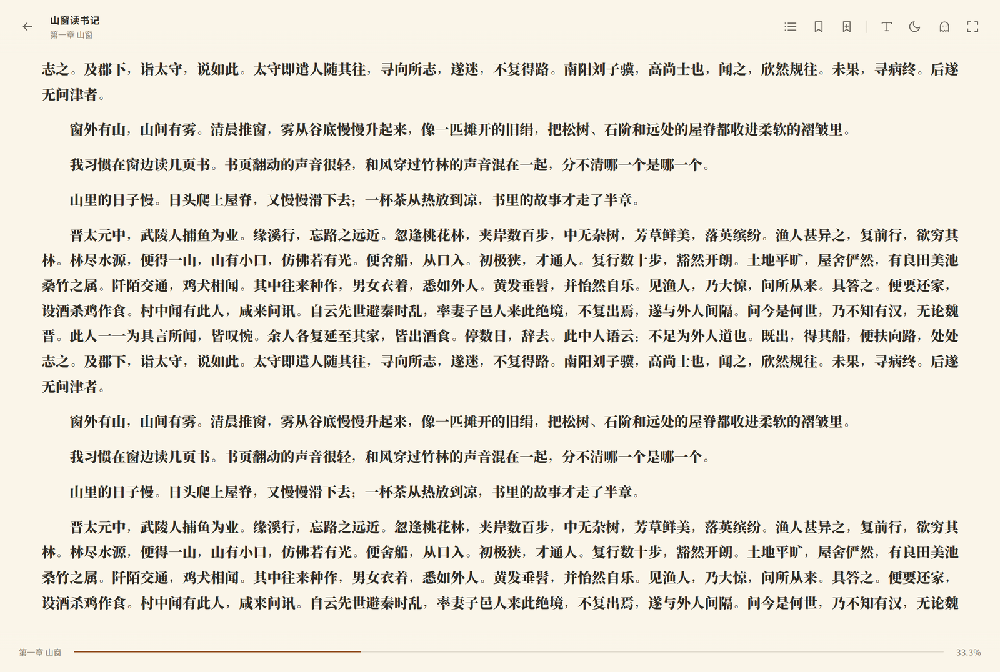
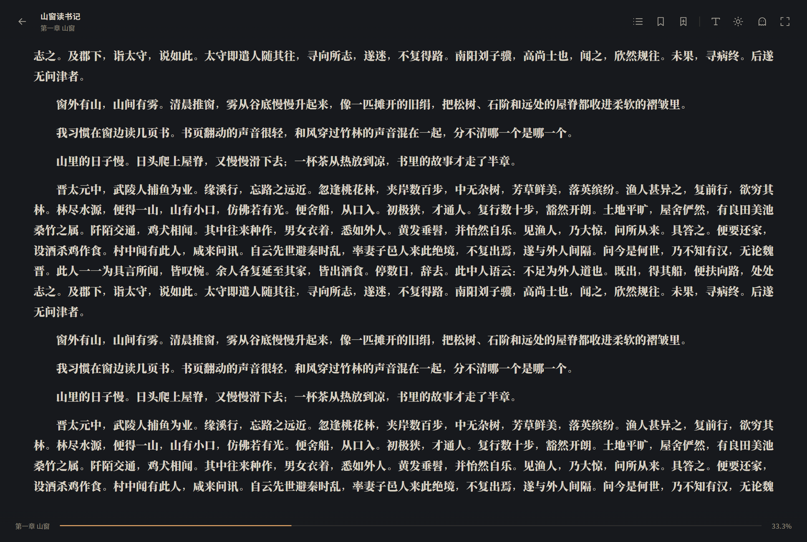

<div align="center">

# 📖 Ebook Viewer

[English](./README.en.md) | [简体中文](./README.md)

一个专注阅读本身的本地 EPUB 阅读器：书库、目录、书签、明亮 / 暗黑主题，以及一个可以随时呼出、随桌面颜色隐身的「摸鱼模式」。

> 当前版本：**v1.0.1** · [GitHub Releases](https://github.com/Bright9025/ebook-viewer/releases)

</div>

## ✨ 功能特点

- 📚 **本地书库** – 导入或拖拽 EPUB，自动提取封面、书名、作者，并记录最近阅读与进度。
- 📖 **专注阅读器** – 横向分页、目录跳转、书签、字号 / 行高 / 页边距 / 字体 / 两端对齐。
- 🌗 **明亮 / 暗黑** – 界面与正文同步换肤，可跟随系统；启动时恢复上次主题，避免白屏闪烁。
- 🪟 **自由缩放** – 改变窗口大小、字号或页边距后重新分页，并尽量把原来的锚点句留在当前页，不整书重载。
- 🫥 **摸鱼模式** – 透明置顶小窗，文字颜色逐字跟随下方桌面；可拖动、可调整大小、可一键隐藏 / 退出。
- ⌨️ **全局快捷键** – 一键隐藏 / 恢复、开关摸鱼模式；摸鱼窗内左右键翻页。
- 🧰 **托盘常驻** – 关闭主窗口不退出，可从托盘恢复；EPUB 文件不会被修改。

## 🧱 技术栈

| 技术 | 用途 |
| --- | --- |
| [](https://www.typescriptlang.org) | 类型安全 |
| [](https://www.electronjs.org) | 桌面应用运行时与主进程能力 |
| [](https://vuejs.org) | 渲染进程界面 |
| [](https://vite.dev) | 前端构建 |
| [](https://electron-vite.org) | main / preload / renderer 一体化开发构建 |
| [](https://pinia.vuejs.org) | 书库、设置、摸鱼状态管理 |
| [](https://router.vuejs.org) | 书库 / 阅读器 / 摸鱼窗路由 |
| [](https://github.com/futurepress/epub.js) | EPUB 解析、CFI 与横向分页 |
| [](https://www.electron.build) | Windows 打包与安装包 |
| [](https://playwright.dev) | 端到端冒烟测试 |

## 🖼️ 界面

| 书库 | 阅读 · 明亮 |
| --- | --- |
|  |  |

| 阅读 · 暗黑 | 排版设置 |
| --- | --- |
|  |  |


> 摸鱼窗是透明置顶的小窗，上图为透明页面叠在浅色背景上的预览；文字颜色会随窗口下方的桌面颜色变化。

## 📁 项目结构

```text
ebook-viewer/
├── docs/
│   └── screenshots/              # 界面截图（README 引用）
├── resources/
│   ├── icons/                    # 应用、托盘、安装包图标
│   └── launcher/                 # Windows 启动器源码与二进制
├── samples/                      # 测试用 EPUB（公版样书 + 中文样书）
├── scripts/
│   ├── dev/                      # 开发 / 预览启动包装
│   ├── setup/                    # Electron 二进制补全
│   └── test/                     # 端到端冒烟测试
├── src/
│   ├── main/                     # Electron 主进程
│   ├── preload/                  # contextBridge API
│   ├── renderer/                 # Vue 3 界面
│   └── shared/                   # 主进程 / 渲染进程共享类型与默认值
├── .gitignore
├── .npmrc                        # Electron 下载镜像
├── LICENSE                       # MIT License
├── CONTRIBUTING.md               # 贡献指南
├── README.md                     # 中文说明（本文件）
├── README.en.md                  # 英文说明
├── electron-builder.yml          # Windows 打包配置
├── electron.vite.config.ts       # main / preload / renderer 构建配置
├── package.json
├── package-lock.json             # 锁定依赖版本
├── tsconfig.json                 # TypeScript 工程引用入口
├── tsconfig.node.json            # main / preload / shared 类型检查
└── tsconfig.web.json             # renderer 类型检查
```

构建和打包生成的 `out/`、`release/` 属于本地产物，已在 `.gitignore` 中忽略，不会提交到仓库。

## 🚀 快速开始

### 环境要求

- Windows 10 / 11
- Node.js ≥ 22.12
- npm ≥ 10

项目固定使用 **Electron 33.4.11**。在这台 Windows 10 19045 + 中文路径的机器上，较新的 Electron 版本会在默认用户目录初始化阶段崩溃（`0xC0000005`）；Electron 33 配合本地 `data/` 目录可以稳定启动，并已通过端到端测试。

### 安装与开发

```bash
npm install
npm run dev
```

`npm run dev` 默认带 `--noSandbox`，并会清除环境中的 `ELECTRON_RUN_AS_NODE`：受限 Windows 会话无法初始化 Chromium 沙箱，不加参数会出现「进程立刻退出、没有窗口」。

如果你的机器沙箱正常，想使用默认安全配置：

```bash
npm run dev:secure
```

### 构建与打包

```bash
npm run build        # 编译 main / preload / renderer 到 out/
npm run start        # 预览生产构建（带 --noSandbox）
npm run pack         # 生成 release/win-unpacked
npm run dist         # 生成 NSIS 安装包（需要额外打包组件）
```

`release/win-unpacked` 里的双击入口是 **`Ebook Viewer.exe`**：它是一个小启动器，会带 `--no-sandbox` 拉起同目录的 **`EbookViewerCore.exe`**（Electron 主体）。不要只复制其中一个文件，整个目录一起使用。

`启动 Ebook Viewer.cmd` 是等价的命令行入口。

打包后的 `release/` 目录结构：

```text
release/
├── win-unpacked/                 # 便携版目录
│   ├── Ebook Viewer.exe          # 双击入口（启动器）
│   ├── EbookViewerCore.exe       # Electron 主体
│   ├── 启动 Ebook Viewer.cmd
│   └── data/                     # 首次启动后生成，便携数据
├── Ebook Viewer-1.0.1-x64.exe    # NSIS 安装包
├── Ebook Viewer-1.0.1-x64.exe.blockmap
├── Ebook-Viewer-v1.0.1-x64-portable.zip
├── latest.yml
└── builder-debug.yml             # electron-builder 调试信息（可忽略）
```

发布到 GitHub Release 时，上传 `Ebook Viewer-1.0.1-x64.exe` 和 `Ebook-Viewer-v1.0.1-x64-portable.zip` 即可；`blockmap`、`latest.yml` 是安装器/自动更新辅助文件，可按需上传。

## 📚 使用

1. 打开程序，点击「导入 EPUB」或把 EPUB 拖入书库。
2. 点击书籍封面进入阅读；首次打开会生成定位信息，进度自动保存。
3. 顶栏可打开目录、添加书签、调整排版、切换主题、进入全屏，以及最小化 / 最大化 / 关闭窗口。
4. 点击工具栏的「摸鱼」按钮，或按 `Ctrl+Shift+M`，打开透明置顶的小窗。
5. 摸鱼窗内用 `←` / `→` 翻页；拖动顶部 26px 移动；右下角斜纹调整大小；右上角工具条隐藏或退出。

## ⌨️ 快捷键

| 快捷键 | 作用 |
| --- | --- |
| `←` / `→` / `PgUp` / `PgDn` / `空格` | 上一页 / 下一页 |
| `Esc` | 关闭目录、设置面板；在摸鱼窗中隐藏 |
| `F11` | 全屏 |
| `Ctrl+Shift+H` | 全局老板键：隐藏 / 恢复全部窗口 |
| `Ctrl+Shift+M` | 全局开关摸鱼模式 |
| 双击摸鱼窗 | 退出摸鱼模式并回到主窗口 |

热键被其他程序占用时，设置面板会给出提示；可在 `data.json` 的 `settings.hotkeys` 中修改。

## 🗂️ 数据位置

默认使用程序旁边的 `data/`，便携且不写用户配置：

- 开发时：`ebook-viewer/.data/`
- 打包后：`release/win-unpacked/data/`

其中：

- `data.json`：书库、设置、书签、阅读进度
- `books/`：导入时复制的 EPUB 文件

可用环境变量 `EBOOK_USER_DATA` 覆盖。若程序目录不可写（例如安装到 `Program Files`），会自动退回 `%APPDATA%\ebook-viewer\`。

> 默认不使用 `%APPDATA%` 的原因：部分 Windows 会话或安全软件环境下，Chromium 初始化用户配置目录时会直接崩溃（`0xC0000005`）；改用可写的本地目录后启动稳定。

## 🧠 技术实现

- **Electron 33 + electron-vite**：主进程、preload、renderer 分离，渲染进程开启 `contextIsolation`，禁用 `nodeIntegration`。
- **Vue 3 + TypeScript + Pinia + Vue Router**：书库、阅读器、摸鱼窗三个路由页面；无第三方 UI 组件库，使用自定义设计 token。
- **epub.js**：负责 EPUB 解析、目录、CFI、横向分页和正文渲染；阅读器保留 `rendition`，缩放时只重排，不重载整本书。
- **自定义 `app://` 协议**：生产构建从 asar 内加载页面，CSP 允许 epub.js 所需的 `blob:` 样式与 frame。
- **桌面取色**：主进程按摸鱼窗矩形截取桌面，渲染进程在独立文本层中逐字渲染，并在每个字所在行的上下留白处采样局部背景，逐字计算颜色。
- **本地存储**：主进程维护 `data.json` 与 `books/`，所有数据留在本机。

## 🎯 首句锚定

1. 每次翻页 / 跳转后，从当前 iframe 的可见区域找到第一个可见字符，向前扩展到可显示的句首，生成 CFI + 句子 + 章节 + 百分比。
2. 窗口 resize 时用固定像素尺寸重新分页，并把锚点 CFI 直接传给 `rendition.resize(width, height, cfi)`，避免 epub.js 自己的 resize 处理把位置带回旧页。
3. 重排后校验锚点是否还在当前页；不在则再 `display(anchor.cfi)` 一次。
4. 缩放过程中不重新采集锚点，所以连续缩放不会累计漂移。字号、行高、页边距变化走同一套逻辑。

> 当前实现保证「锚点句仍在当前页」；由于 EPUB 分页只能按列/页边界切分，锚点句不一定总是页面第一行。完全逐字锁定首行需要连续滚动布局或自研分页器，尚未实现。

## 🫥 摸鱼模式

- 透明、无边框、置顶、跳过任务栏，适合在旁边快速看几行。
- 内文由独立文本层逐字渲染，颜色按每个字下方的局部背景计算：亮背景给深字，暗背景给浅字，对比度约 2.6–3.6:1。
- 显示 / 移动时重新取色，静止时每 2 秒刷新。
- 工具条只保留「隐藏」和「退出」；尺寸通过右下角手柄自由调整。
- 摸鱼窗不显示图片，只显示当前页文字。

## ⚠️ 已知边界

- 只支持 EPUB，不支持 PDF / MOBI / AZW3。
- 不同窗口尺寸下页边界会变化，首句锚定保证不跨页、不丢位置，但不保证锚点句永远是第一行。
- 摸鱼窗只显示文字，图片默认隐藏。
- 全局快捷键可能与其他软件冲突。
- 局部受限的 Windows 会话需要 `--no-sandbox`，因此默认开发命令与启动脚本关闭了 Chromium 沙箱；EPUB 内容仍在禁用脚本的 iframe 中渲染。

## 📄 许可证

本项目采用 [MIT License](./LICENSE) 开源，可自由使用、修改和分发。

## 🤝 贡献

欢迎提交 Issue 或 Pull Request；完整开发、提交与测试流程见 [CONTRIBUTING.md](./CONTRIBUTING.md)。提交前请先运行：

```bash
npm run typecheck
npm run test:e2e
```

## 📧 联系方式

如有问题，请通过 GitHub Issues 联系。

**Happy reading! 📖**
